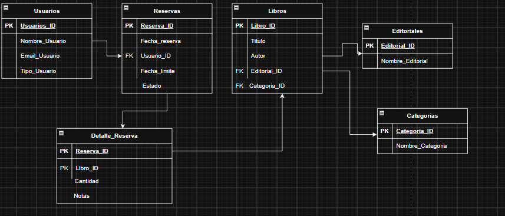

<h1 align="center">Bookly-proyecto integrador grupo 3</h1>

<p align="center">aplicacion web para la gestion de libros,usuarios y reservas de una biblioteca</p>

<p align="center">
  
  
  
  
  
  
</p>
## Resumen Ejecutivo

**Problema.** La gestión manual de reservas de libros en una biblioteca dificulta saber qué usuario tiene qué libro, hasta cuándo y en qué estado se encuentra cada reserva.

**Solución.** Aplicación web desarrollada en Java con Vaadin para la interfaz y JDBC para el acceso a datos. Permite administrar usuarios, libros, reservas y el detalle de cada reserva mediante operaciones CRUD completas (crear, consultar, actualizar y eliminar).

**Valor del sistema.** Centraliza la información de la biblioteca, reduce errores de registro y permite consultar rápidamente el estado de las reservas y las fechas límite de devolución.

## Arquitectura

El proyecto sigue una arquitectura en capas:

```
Vista (Vaadin)  ->  DAO (JDBC, mapeo manual)  ->  Base de datos
                          |
                     Modelo (POJO)
```

| Capa | Paquete | Responsabilidad |
|------|---------|-----------------|
| Modelo | `com.example.model` | Clases POJO que representan las entidades del MER |
| Acceso a datos | `com.example.dao` | Operaciones CRUD con JDBC y mapeo manual entre `ResultSet` y objetos |
| Vista | `com.example.view` | Interfaces en Vaadin con formulario, botones y tabla por entidad |

Estructura del proyecto:

```
proyecto-integrador-b2-2026/
├── README.md
├── LICENSE.md
├── Dockerfile
├── pom.xml
├── mvnw
├── mvnw.cmd
├── docs/
│   └── mer.png
├── sql/
│   └── script.sql
└── src/main/
    ├── frontend/
    ├── resources/
    └── java/com/example/
        ├── Application.java
        ├── MainView.java
        ├── model/
        ├── dao/
        └── view/
```

## Modelo de Datos

(MER: ).

| Entidad | Descripción | Atributos |
|---------|-------------|-----------|
| **Usuarios** | Personas que realizan reservas | Usuario_ID (PK), Nombre_Usuario, Email_Usuario, Tipo_Usuario |
| **Libros** | Catálogo de la biblioteca | Libro_ID (PK), Titulo, Autor, Editorial, Categoria |
| **Reservas** | Reserva realizada por un usuario | Reserva_ID (PK), Fecha_reserva, Usuario_ID (FK), Fecha_limite, Estado |
| **Detalle_Reserva** | Libros incluidos en cada reserva | Reserva_ID (PK, FK), Libro_ID (PK, FK) |

**Relaciones:**

- Un usuario puede tener muchas reservas.
- Una reserva puede incluir muchos libros y un libro puede estar en muchas reservas, resuelto con la tabla `Detalle_Reserva`.

## Stack Tecnológico

| Tecnología | Versión |
|------------|---------|
| Java (JDK) | 21 |
| Maven Wrapper | Incluido en el proyecto (`mvnw`) |
| Vaadin | 25.x |
| SQL Server | 2022 (ajustar a la versión instalada) |
| Driver JDBC (mssql-jdbc) | 12.x |
| Herramienta de base de datos | SQL Server Management Studio (SSMS) |
| IDE | VS Code |
| Control de versiones | Git y GitHub |

## Guía de Configuración

### Pre-requisitos

- JDK 21 o superior
- SQL Server (Express o Developer) en ejecución
- SQL Server Management Studio (SSMS)
- Git

No es necesario instalar Maven: el proyecto incluye Maven Wrapper.

### 1. Clonar el repositorio

```bash
git clone https://github.com/USUARIO/NOMBRE-REPOSITORIO.git
cd NOMBRE-REPOSITORIO
```

### 2. Crear la base de datos

1. Abrir SQL Server Management Studio y conectarse a la instancia local.
2. Abrir el archivo `sql/script.sql` (menú Archivo, Abrir, Archivo).
3. Ejecutarlo con el botón **Ejecutar** o la tecla `F5`. El script crea la base de datos `biblioteca` y sus cuatro tablas.

### 3. Configurar la conexión

Definir las siguientes variables de entorno:

| Variable | Descripción | Ejemplo |
|----------|-------------|---------|
| `DB_URL` | URL de conexión | `jdbc:sqlserver://localhost:1433;databaseName=biblioteca;encrypt=true;trustServerCertificate=true` |
| `DB_USER` | Usuario de SQL Server | `sa` |
| `DB_PASSWORD` | Contraseña | `********` |

### 4. Compilar y ejecutar

En Linux o macOS:

```bash
./mvnw clean install
./mvnw spring-boot:run
```

En Windows:

```bash
mvnw.cmd clean install
mvnw.cmd spring-boot:run
```

### 5. Abrir la aplicación

Ingresar en el navegador a `http://localhost:8080`.

### Compilar para producción

```bash
./mvnw package
```

## Flujo de Trabajo

El control de versiones se maneja con Git y GitHub:

- `main`: rama estable, solo recibe código probado.
- `develop`: rama de integración.
- `feature/<nombre>`: una rama por funcionalidad (por ejemplo `feature/crud-libros`).
- Los cambios se integran a `develop` mediante pull requests.
- Los mensajes de commit describen brevemente el cambio realizado.

## Licencia y Créditos

Proyecto distribuido bajo la licencia indicada en el archivo [LICENSE.md](LICENSE.md).

| Integrante | Rol |
|------------|-----|
| Juan Esteban Rave| Capa de persistencia (POJO y DAO) |
| Juan Esteban Ceballos | Vistas en Vaadin |
| Diego Tobon | Base de datos y documentación |

Proyecto académico desarrollado para el curso de [desarrollo de software] - [Cesde-bello].
